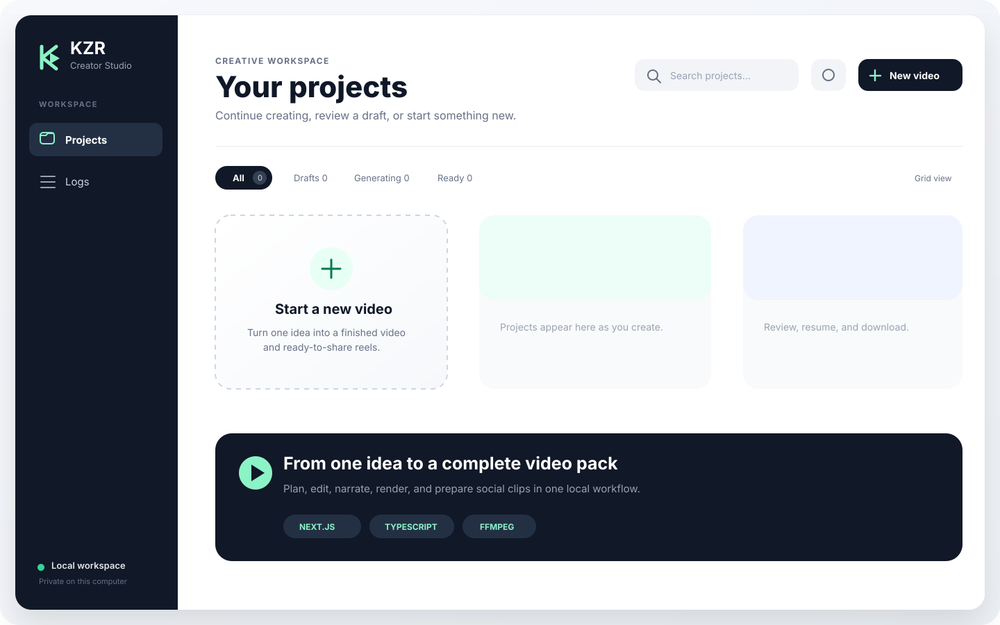

# KZR Video Generator

A local-first AI video studio that turns a topic into a narrated explainer or two-sided debate, then produces a thumbnail, voice-over, long-form video, and three vertical social clips.

The project includes a guided Next.js interface and a scriptable TypeScript CLI. Generation runs on your machine: OpenAI creates structured scripts and speech, Pexels can supply optional stock photography, and FFmpeg assembles the final media.



> [!IMPORTANT]
> This is a single-user local application, not a hardened multi-tenant service. Its API routes can start paid model calls and access local project files. Do not expose it directly to the public internet.

## What it can do

- Create narrated explainers or host-led debates from a topic and creative brief.
- Review and edit scripts, metadata, thumbnails, and scene visuals between stages.
- Render long-form landscape videos and three portrait reels/shorts.
- Resume failed stages without repeating completed work.
- Track estimated model usage and per-stage timing.
- Optionally publish finished media to YouTube and Instagram.

## Requirements

- Node.js 20.9 or newer
- npm
- FFmpeg and FFprobe available on `PATH`
- An OpenAI API key with billing enabled
- Optional: a Pexels API key and social publishing credentials

## Quick start

```bash
git clone https://github.com/kzrfaisal/kzr-video-generator.git
cd kzr-video-generator
npm install
cp .env.example .env
```

Add `OPENAI_API_KEY` to `.env`, then start the guided interface:

```bash
npm run next:dev
```

Open `http://localhost:3000`. API usage can incur charges, so review the selected models and video settings before starting a full run.

To verify a checkout without making paid API calls:

```bash
npm run typecheck
npm test
npm run next:build
```

## Configuration and credentials

Copy `.env.example` to `.env`. The local `.env` file is ignored by Git and must never be committed.

| Variable | Required | Purpose |
|---|---:|---|
| `OPENAI_API_KEY` | Yes | Structured script generation and text-to-speech |
| `PEXELS_API_KEY` | No | Topic-specific stock photos for infographic scenes |
| `YOUTUBE_*` | No | YouTube upload credentials and defaults |
| `INSTAGRAM_*`, `META_GRAPH_VERSION` | No | Instagram publishing credentials and defaults |

All non-secret rendering defaults live in [`config.ts`](config.ts).

## Project status

KZR Video Generator is an early open-source project built for trusted local use. Expect active changes to workflows and file formats. See [`docs/open-source-launch.md`](docs/open-source-launch.md) for the remaining release gates.

- Contributions: [`CONTRIBUTING.md`](CONTRIBUTING.md)
- Security and deployment warning: [`SECURITY.md`](SECURITY.md)
- Architecture: [`docs/architecture.md`](docs/architecture.md)
- Third-party assets: [`THIRD_PARTY_NOTICES.md`](THIRD_PARTY_NOTICES.md)

Released under the [MIT License](LICENSE). Bundled third-party assets retain their own licenses as listed in [`THIRD_PARTY_NOTICES.md`](THIRD_PARTY_NOTICES.md).

## Local web app and automatic publishing

Start the app on the laptop:

```bash
npm run next:dev
```

Open `http://localhost:3000`, enter a title/topic and context, then click **Create full video pack**. Choose a narrated explainer or two-sided debate, plus character or infographic visuals. Selecting infographic visuals automatically defaults new projects to a single-narrator explainer. The app generates the script, metadata, thumbnail, audio, main video, and three portrait videos. Finished files can be downloaded together as a ZIP. Publishing to YouTube and Instagram remains available as an optional final step; upload receipts make retries skip posts that already succeeded.

For topic-specific infographic photos, create a free API key at [Pexels API](https://www.pexels.com/api/), add it as `PEXELS_API_KEY` in `.env`, and restart the app. The app downloads and caches one photo per three dialogue lines, shows every photo for review, and saves photographer credits with the download pack. Without this key, character-debate videos still work normally.

One-time social account setup:

1. In Google Cloud, enable the YouTube Data API, create an OAuth web client, authorize the `https://www.googleapis.com/auth/youtube.upload` scope, and put its client ID, client secret, and refresh token in `.env`.
2. Use a professional Instagram account linked to a Facebook Page. Create a Meta Business app, authorize `pages_show_list`, `instagram_basic`, `instagram_content_publish`, and `pages_read_engagement`, then put the Instagram professional account ID and Facebook Page access token in `.env`.
3. Copy the publishing settings from `.env.example`. Set `YOUTUBE_PRIVACY_STATUS=public` when your API project is approved for automatic public YouTube posts; the safer default is `private`.

Videos upload directly from the laptop to YouTube and Meta. No Cloudflare R2 or other storage service is used.

### Project data

Each project's versioned `output/debates/debateN.project.json` file is its source of
truth. It contains stable script scenes, visual instructions, metadata, and project
configuration. The neighboring `.txt` script and `.metadata.md` files are compatibility
exports. See [the project schema](docs/project-schema.md).

---

## Full Pipeline

```bash
# Generate script + pause for review + generate audio + generate video
npm start "AI replacing teachers"
```

When the run completes, a **Run Report** prints with token counts, character counts, USD/INR cost, and per-stage timing. The same data is appended to `output/cost_log.jsonl`.

---

## Configuration

All user-tunable settings live in [`config.ts`](config.ts). The file has three parts:

1. **`baseConfig`** — defaults used by every video.
2. **`VIDEO_STYLES`** — a map of preset name → `Partial<Config>`. Each preset declares only the fields that differ from the defaults.
3. **`config`** (exported) — the active config, computed as `{ ...baseConfig, ...VIDEO_STYLES[baseConfig.videoStyle] }`.

The merge is **shallow** — nested maps (`images`, `voices`, `subtitleStyle`) are replaced as a whole. If a preset wants to change one entry in a map, it must spell out the full map.

### Feature flags

| Field | Values | Notes |
|---|---|---|
| `createTransitionVideos` | `true` / `false` | Auto-generate prerendered transition video clips during `npm start`. Only runs when `includeTransitionVideos` is also `true`. |
| `includeTransitionVideos` | `true` / `false` | Insert prerendered transition video clips between speaker switches in the final video. |
| `transitionStyle` | `'none'` / `'fade'` | Style applied between consecutive segments at concat time. `'none'` = hard cut (default). `'fade'` = ffmpeg `xfade` crossfade between every adjacent pair (uses `transitionDuration` for the crossfade length). Orthogonal to `includeTransitionVideos`. |
| `videoStyle` | `'style1'` / `'style2'` / `'style3'` | Active preset key in `VIDEO_STYLES`. See [Video Styles](#video-styles) below. |
| `isReelStyle` | `true` / `false` | When `true`, video segments and transitions render at 1080×1920 (9:16). Set automatically by the `style3` preset. |

### Images

| Field | Description |
|---|---|
| `images` | `{ HOST, A, B }` map of speaker → image path. Each preset can override this whole map. |

### Audio / TTS

| Field | Default | Notes |
|---|---|---|
| `ttsModel` | `'tts-1'` | OpenAI TTS model. Use `'tts-1-hd'` for higher quality (more expensive). |
| `ttsSpeed` | `1.0` | Speech rate, 0.25–4.0. |
| `voices` | `{ HOST: 'alloy', A: 'echo', B: 'onyx' }` | Per-speaker OpenAI voice. |

### Script generation

Prompts are versioned in `src/services/openai/prompts.ts`. Script, metadata, and visual
planning use the Responses API with Zod Structured Outputs; see
[the generation-layer notes](docs/openai-generation.md).

The source code is separated into domain, feature, infrastructure, service, and shared
layers. See [the architecture guide](docs/architecture.md) before adding a new module.

Generation attempts and per-project stage status are persisted locally, so a failed stage
can be retried without rerunning completed stages. See [pipeline reliability](docs/pipeline-reliability.md).

| Field | Default | Notes |
|---|---|---|
| `scriptModel` | `'gpt-4o-mini'` | OpenAI model used for structured script, metadata, and visual-plan generation. |
| `videoLengthTarget` | `'5-7 minutes'` | Passed as a user preference to the structured script generator. |
| `generateMetadata` | `true` | When `true`, the script stage also produces `debateN.metadata.md` (YouTube title, description, hashtags, 3 reel captions). Hashtags are generated without web search; reel captions are prefixed with `Part N - <YouTube title>`. Costs one additional `scriptModel` call. Set to `false` to skip. |
| `generateThumbnail` | `true` | When `true`, the script stage also renders a 1280×720 `debateN.thumbnail.jpg` using `thumbnailBackground` + the `## Thumbnail Hook` line from the metadata file. Requires `generateMetadata: true`. No extra OpenAI call. |
| `thumbnailBackground` | `'assets/images/image_H.png'` | Background image overlaid with the `DEBATE` label + center hook text by ffmpeg `drawtext`. Any 16:9 image works; non-16:9 is letterboxed with black bars. |
| `thumbnailFont` | `{ font, label: { size, color, x, y }, hook: { size, color, x, y } }` | Object holding the thumbnail's `.ttf` font plus per-element `size`, `color`, `x`, `y` for the `label` and the `hook`. `color` accepts named colors (`white`, `gold`), hex (`0xFF6B35`), or `name@alpha`. `x`/`y` accept raw pixels (`'80'`) **or** ffmpeg drawtext expressions: `w`/`h` = canvas size (1280/720), `text_w`/`text_h` = rendered text size — so `(w-text_w)/2` centers horizontally and `(h-text_h)/2-80` centers vertically then shifts up 80px. Kept separate from `font` so subtitle styling is unaffected. |
| `bannerFont` | `{ font, size, color, wrapWidth, lineHeight, glow? }` | Styling for the persistent `Part N - <title>` banner shown vertically centered on reel videos. Mirrors the thumbnail hook look: a solid fill over a soft glow. `font` is a `.ttf` path — ffmpeg has no bold flag, so pick a bold/heavy face for a bold look. `color` accepts named/hex/`name@alpha`. `glow` = `{ color, passes: [{ w, a }] }` renders a halo behind the text (stacked drawtext passes, widest/faintest first) — omit for no glow. Kept separate from `font` so the banner can look distinct from the subtitles. Only rendered for reels. |

### Subtitles

| Field | Default | Notes |
|---|---|---|
| `subtitleStyle` | `{ HOST, A, B }` | Per-speaker map → key from the `STYLES` map in `config.ts`. Default has every speaker on `top-classic`. |
| `font` | `'assets/fonts/Nunito-Regular.ttf'` | Default font; can be overridden per style. |
| `subtitleLineHeight` | `50` | Default gap (px) between stacked subtitle lines. |
| `subtitleWrapWidth` | `72` | Default max characters per line before wrapping. |

### Video encoding

| Field | Default | Notes |
|---|---|---|
| `videoCrf` | `18` | libx264 quality. 0–51, lower = better. |
| `videoPreset` | `'slow'` | libx264 preset. `ultrafast` → `veryslow`. |
| `fps` | `30` | Output frame rate. |
| `audioPadding` | `0.4` | Silence (seconds) appended to each spoken clip. |
| `fadeInDuration` | `0.12` | Fade-in length at start of final video. |

### Transitions

| Field | Default | Notes |
|---|---|---|
| `transitionEffect` | `'fade'` | ffmpeg `xfade` effect name (e.g. `fade`, `wipeleft`, `slideleft`). |
| `transitionDuration` | `1` | Animation length in seconds. |

---

## Video Styles

Presets live in the `VIDEO_STYLES` map in [`config.ts`](config.ts). Switch the active preset via `baseConfig.videoStyle` **or** override per-run with `--style=<name>` on the command line. Each preset is a `Partial<Config>` — list only what differs from the defaults.

| Preset | Purpose | Key overrides |
|---|---|---|
| `style1` | Default 16:9 debate | (none — pure defaults) |
| `style2` | Same 16:9, abstract host background + big-center subtitle for HOST only | `images.HOST`, `subtitleStyle.HOST` |
| `style3` | 9:16 Reels/Shorts, 30–60s, portrait images, big-center subtitles | `isReelStyle`, `videoLengthTarget`, `transitionDuration`, `subtitleStyle`, `images` |

### Picking the style per run (no config edit)

Any CLI entry point reads `--style=<name>` (or env `npm_config_style`) at startup and uses it instead of `baseConfig.videoStyle`:

```bash
npm start "AI replacing teachers" --style=style2     # full pipeline, 16:9 host-bg variant
npm run video debate12 --style=style1                # rebuild video for an existing debate at 16:9
npm run reels debate10                               # reels script bakes in --style=style3, so no flag needed
npm run video -- debate12 --style=style3             # direct feature command
```

Both forms work because npm exposes `--style=X` as the env var `npm_config_style`, which `config.ts` also reads. If you prefer the standard npm passthrough, `npm run video debate12 -- --style=style1` works as well.

Unknown style names fail fast with the list of valid keys.

### Adding a new style

```ts
// in config.ts VIDEO_STYLES map
'my-style': {
  // Only list what differs from baseConfig.
  // Nested maps are replaced as a whole, so spell them out fully if you touch them.
  subtitleStyle: { HOST: 'card', A: 'card', B: 'card' },
  videoLengthTarget: '3-4 minutes',
},
```

Then set `videoStyle: 'my-style'` in `baseConfig`.

---

## Subtitle Styles

Styles are defined in the `STYLES` map in `config.ts`. The active preset picks which style applies per speaker via the `subtitleStyle` map. Built-ins:

| Style | Look |
|---|---|
| `youtube-classic` | White text, thick black outline |
| `card` | White text on a semi-transparent dark box |
| `bold-yellow` | Yellow text with heavy black border |
| `glow` | White text with a strong drop shadow |
| `lower-third` | White text on a full-width navy bar |
| `top-classic` | White text with a small shadow (default) |
| `big-center` | Very large, vertically-centered (used automatically for HOST in `style2`) |
| `reels-top` | Mobile-friendly: medium size, upper-third placement, narrow wrap so 4–5 lines fit (used by `style3`) |

### Per-style overrides

Each entry in `STYLES` can override the global config for that style only:

| Field | Overrides | Example |
|---|---|---|
| `font` | `config.font` | Use a non-italic font for one style |
| `wrapWidth` | `config.subtitleWrapWidth` | Wrap sooner for a larger font |
| `lineHeight` | `config.subtitleLineHeight` | More breathing room between lines |

### Adding a new style

```ts
// in config.ts STYLES map
'my-style': {
  fontsize: 50,
  fontcolor: 'white',
  bordercolor: 'black', borderw: 3,
  position: 'top',        // 'top' | 'bottom' | 'center'
  margin: 100,
  // optional overrides:
  font: 'assets/fonts/Nunito-Regular.ttf',
  wrapWidth: 40,
  lineHeight: 60,
},
```

Then set `subtitleStyle: 'my-style'`.

---

## Run Individual Stages

```bash
# 1. Generate debate script only (saves to output/debates/debateN.txt)
npm run script "AI replacing teachers"
# or
npm run script -- "AI replacing teachers"

# 2. Generate audio for a debate (reads output/debates/debate1.txt)
npm run audio debate1
# or
npm run audio -- debate1

# 3. Generate video segments + build final video
npm run video debate1
# or
npm run video -- debate1

# Run video stages separately:
tsx src/features/rendering/createVideoSegments.ts debate1
tsx src/buildVideo.ts debate1
```

---

## Reels From an Existing Debate

After generating a long-form debate, you can split its script into three reel-sized parts (opening, rebuttals, closing) and produce a short video for each — reusing the audio that was already generated for the long-form debate (no extra TTS spend).

```bash
# 1. Switch to the reels preset in config.ts:
#    videoStyle: 'style3'    (sets isReelStyle, portrait images, 'reels-top' subtitles)

# 2. One command: extracts 3 part scripts → pauses for review →
#    reuses debate10's audio → builds 3 reel videos.
npm run reels debate10
# or
npm run reels -- debate10
```

Under the hood the command:

1. Splits `output/debates/debate10.txt` into `output/debates/reels/debate10_part{1,2,3}.txt`.
2. Pauses so you can review the 3 part scripts.
3. Copies the relevant `.mp3` files from `output/audios/debate10/` into `output/audios/reels/debate10_part{1,2,3}/`, renumbered sequentially per part. **No TTS is re-run.**
4. Builds a video for each part. Finals land in `output/videos/reels/debate10_partN_TIMESTAMP.mp4`.

The split expects the long-form prompt's structure (HOST → A → HOST → B, three rounds, optional HOST summary). If the LLM deviated from that, the extractor errors out so you can adjust manually.

### Lower-level alternatives

If you'd rather drive the steps yourself (e.g. to tweak a part script before audio is copied, or to rerun a single part):

```bash
# Just split the script — does NOT copy audio or build video.
npm run extract-reel-scripts debate10

# Then for each part, either reuse the makeReels copy step manually or
# regenerate audio + video the normal way:
npm run audio reels/debate10_part1   # WARNING: spends TTS cost
npm run video reels/debate10_part1
```

---

## Transition Videos

Run these when you replace speaker images (`assets/images/image_H.png`, `image_A.png`, `image_B.png`) or change `config.transitionEffect` / `config.transitionDuration`.

```bash
# Regenerate all 6 transition videos
npm run transitions
# or
npm run transitions

# Regenerate one specific transition (FROM and TO are H, A, or B)
npm run transitions -- B H
npm run transitions -- H A

# Add audio to all transition videos
# Requires: assets/audios/transition_audio.wav
npm run transition-audio
# or
npm run transition-audio

# Add audio to one specific transition
npm run transition-audio -- transition_B_to_H
```

> Note: `addTransitionAudio` writes to a `.tmp.mp4` first, then renames over the original — so ffmpeg never reads and writes the same file simultaneously.

When `config.createTransitionVideos === true` and `config.includeTransitionVideos === true`, `npm start` runs both transition generation and audio attach automatically as part of the pipeline.

---

## Output

- Project source: `output/debates/debateN.project.json`
- Script compatibility export: `output/debates/debateN.txt`
- Publishing metadata export: `output/publish/debateN/debateN.metadata.md`
- Thumbnail: `output/publish/debateN/debateN.thumbnail.jpg`
- Audio: `output/audios/debateN/`
- Final videos: `output/videos/reels/` (when `isReelStyle: true`) or `output/videos/others/` (otherwise), named `debateN_TIMESTAMP.mp4`
- Cost / timing log (JSONL, one run per line): `output/cost_log.jsonl`
- Temp files (auto-deleted): `tmp/`

---

## Assets

| Path | Description |
|---|---|
| `assets/images/image_H.png` | AI-generated HOST portrait used by `style1` |
| `assets/images/image_A.png` | AI-generated Speaker A portrait used by `style1` and `style2` |
| `assets/images/image_B.png` | AI-generated Speaker B portrait used by `style1` and `style2` |
| `assets/images/image_H_style2.png` | AI-generated abstract HOST background used by `style2` |
| `assets/images/image_H_style3.png` | AI-generated infographic fallback for portrait videos |
| `assets/images/reels/image_H.png` | AI-generated portrait HOST image used by `style3` |
| `assets/images/reels/image_A.png` | AI-generated portrait Speaker A image used by `style3` |
| `assets/images/reels/image_B.png` | AI-generated portrait Speaker B image used by `style3` |
| `assets/videos/transition_*.mp4` | 6 transition clips (H↔A, H↔B, A↔B) |
| `assets/fonts/Nunito-Regular.ttf` | Bundled OFL-licensed font for subtitles, thumbnails, and banners |
| `assets/audios/transition_audio.wav` | Audio attached to transition clips |

> Tip: For 16:9 styles keep speaker images close to ~1380×752 (matching dimensions across all three). For `style3` use portrait 1080×1920 images. Oversize images (for example 5000×3000) drastically slow FFmpeg encoding.

> Note: Regenerate transitions (`npm run transitions`) after switching `videoStyle` between 16:9 and `style3`, since the active `videoStyle`'s `images` map and aspect ratio are baked into the transition clips.

---

## Commands

All commands accept `--style=<name>` to override `baseConfig.videoStyle` for that run (see [Picking the style per run](#picking-the-style-per-run-no-config-edit)).

### End-to-end pipelines

```bash
npm start "AI replacing teachers"
```
Full pipeline: generates the debate script + metadata, pauses for review (edit the script or the `## Thumbnail Hook` line in `debateN.metadata.md`), renders the thumbnail, runs TTS, builds the final video.

**Optional framing with `--context`:** pass a `--context="..."` string to steer the debate's angle, cite a real event, or force a specific framing. Flows into the debate prompt (so HOST + debaters engage with the specific angle instead of an invented generic one) and the metadata prompt (so the YouTube Description references those specifics too). Supported on `npm start`, `npm run all`, and `npm run script`.

```bash
npm start "AI replacing teachers" \
  --context="LA Unified just banned ChatGPT from classrooms this month. Frame the debate around whether AI is a teacher-replacement threat or a pedagogy upgrade, and reference the LA ban as the trigger."
```

For multi-line or shell-heavy context, put it in a file and pass `--context="$(cat framing.txt)"`.

```bash
npm run reels debate10
```
Reuses an existing long-form debate's audio to build three reel videos (opening, rebuttals, closing). No per-reel TTS cost for the debate lines. The script hardcodes `--style=style3` so reels always render 9:16 into `output/videos/reels/` regardless of what `baseConfig.videoStyle` is set to. Each reel ends with a distinct HOST outro line asking viewers to comment; audio for each of the three outros is generated once via OpenAI TTS on first run and cached at `assets/audios/reels/host_outro_partN.mp3` — reused across every subsequent debate.

```bash
npm run all "AI replacing teachers"
```
End-to-end YouTube + reels in one command: runs the full `npm start` pipeline, then spawns the reels pipeline (with `--style=style3`) reusing the same audio. Two ENTER review prompts — one before TTS, one before reel-video build.

### Individual stages

```bash
npm run script "AI replacing teachers"
npm run script "AI replacing teachers" --context="LA Unified just banned ChatGPT this month..."
```
Generates the debate script (`output/debates/debateN.txt`), and when `generateMetadata: true` (default) also the publishing metadata file (`debateN.metadata.md`). Accepts an optional `--context="..."` to steer the framing (see the `npm start` section for details). Costs script-model tokens (script + one extra small call for metadata). Does **not** render the thumbnail — that happens in the full `npm start` flow after the review pause (so hook edits take effect), or on demand via `npm run thumbnail debateN`.

```bash
npm run thumbnail debate1
```
Regenerates only `output/debates/debate1.thumbnail.jpg` from the existing `debate1.metadata.md` (`## Thumbnail Hook` line) + current `thumbnailBackground` / `font` config. Free (ffmpeg only) — use this to iterate on fonts, colors, or layout without re-running the script stage.

```bash
npm run audio debate1
```
Runs OpenAI TTS for every line of `output/debates/debate1.txt` and writes per-line mp3s to `output/audios/debate1/`. Costs TTS characters.

```bash
npm run video debate1
```
Builds segments + final video from existing audio. Free (ffmpeg only). Honors `createTransitionVideos`/`includeTransitionVideos` to regenerate and splice transition clips.

### Reels helpers

```bash
npm run extract-reel-scripts debate10
```
Splits `output/debates/debate10.txt` into three reel-sized part scripts under `output/debates/reels/`. Does not copy audio or build video — use this when you want to edit part scripts manually before continuing.

### Transition assets

```bash
npm run transitions
```
Rebuilds all six speaker-to-speaker transition video clips at the active style's dimensions. Run after swapping images or changing `transitionEffect`/`transitionDuration`.

```bash
npm run transitions -- H A
```
Rebuilds a single transition (`H → A` here). Speaker codes: `H`, `A`, `B`.

```bash
npm run transition-audio
```
Mixes `assets/audios/transition_audio.wav` into all transition clips in place (via a `.tmp.mp4` swap).

```bash
npm run transition-audio -- transition_B_to_H
```
Adds the transition audio to a single named clip.
